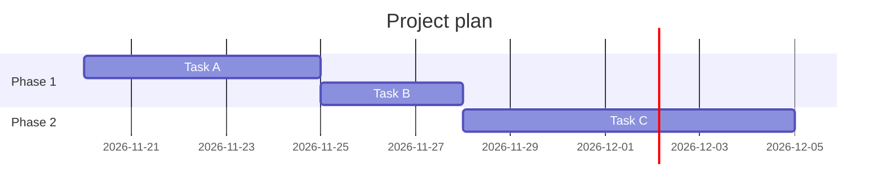

# AGENTS.md

Instructions for AI coding agents (and humans) working in this repository.
`CLAUDE.md` is a symlink to this file, so every agent reads the same rules.

## Language

- **Everything in this repository is written in English**: source code, identifiers,
  comments, commit messages, and all Markdown files (including `ROADMAP/` and `RECORD/`).
- This applies even when the conversation with the agent happens in another language.

## Project plan: `ROADMAP/`

The project plan lives in `ROADMAP/YYYY-MM-DD/`, one directory per planning date.

- Each directory contains one or more `.md` files describing the plan made on that date
  (goals, scope, milestones, dependencies, risks).
- Every plan file includes at least one **Mermaid Gantt diagram** showing the schedule.
- When the plan changes significantly, create a new dated directory instead of rewriting
  history; the most recent directory is the current plan.

Example:

```
ROADMAP/
└── 2026-11-20/
    ├── overview.md
    └── milestone-1.md
```

Gantt template:

````markdown

````

## Project memory: `RECORD/`

`RECORD/` is the project's long-term memory: decisions, progress, findings and context
that future sessions need.

File naming: `RECORD/YYYY-MM-DD.<summary>.(WIP|completed).md`

- `YYYY-MM-DD` — the date the record was started.
- `<summary>` — short kebab-case description (e.g. `auth-refactor`).
- Status suffix:
  - **`.WIP.md` — append-only.** Add new entries at the end; never edit or delete
    existing content. Use dated/timestamped entries.
  - **`.completed.md` — read-only.** Never modify. If follow-up is needed, start a new
    record that references it.
- To close a record, rename it from `.WIP.md` to `.completed.md` (the rename is the
  only allowed change), optionally after appending a final summary entry.

Example:

```
RECORD/
├── 2026-11-20.template-setup.completed.md
└── 2026-11-21.auth-refactor.WIP.md
```

### Agent workflow

1. At the start of a task, read the latest `ROADMAP/` directory and any relevant
   `RECORD/*.WIP.md` files.
2. While working, append progress, decisions and open questions to the matching
   `.WIP.md` record (create one if none fits).
3. When the work is done, append a final summary and rename the record to `.completed.md`.
4. Update the roadmap (new dated directory) when scope or schedule changes.
