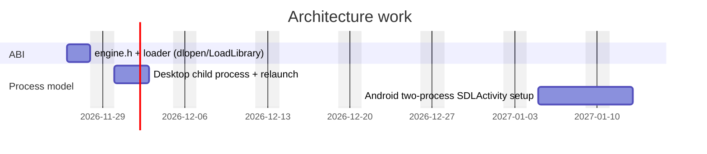

# rsdk-air — architecture (2026-11-20)

## Layout

```
rsdk-air/
├── CMakeLists.txt
├── include/rsdkair/engine.h     # the C ABI every engine module exports
├── launcher/                    # rsdk-air executable: detection, picker, relaunch
├── engines/
│   ├── rsdkv3/                  # wrapper + CMake around the submodule
│   ├── rsdkv4/
│   ├── rsdkv5/                  # RSDKv5U + Sonic Mania game logic
│   └── sonic3air/
├── third_party/                 # SDL2, Dear ImGui, engine submodules
└── android/                     # Gradle project (SDLActivity based)
```

Build output on desktop:

```
rsdk-air(.exe)
SDL2.dll / libSDL2.so / libSDL2.dylib
engines/rsdkv3.{dll,so}      (.so on Linux and macOS: CMake MODULE libraries)
engines/rsdkv4.{dll,so}
engines/rsdkv5.{dll,so}
engines/sonic3air.{dll,so}
```

## Engine ABI

Each engine module is a shared library built with `-fvisibility=hidden`
(`/DEF` exports on Windows, an exported-symbols list on macOS). It exports only:

```c
#define RSDKAIR_ABI_VERSION 1

typedef struct RsdkAirGameInfo {
    const char *id;          /* "sonic1", "sonic2", "soniccd", "mania", "s3air" */
    const char *title;
    const char *const *required; /* NULL-terminated, relative to its data dir */
} RsdkAirGameInfo;

typedef struct RsdkAirEngineArgs {
    int         abi_version;
    const char *game_id;
    const char *data_dir;    /* read-only game data, e.g. <pref>/games/sonic1 */
    const char *save_dir;    /* writable, e.g. <pref>/saves/sonic1 */
    int         argc;
    char      **argv;
} RsdkAirEngineArgs;

/* Games this module can run (RSDKv4 lists two). */
RSDKAIR_EXPORT const RsdkAirGameInfo *const *rsdkair_engine_games(void);

/* Runs the game until it exits. Returns 0 on a normal exit. */
RSDKAIR_EXPORT int rsdkair_engine_main(const RsdkAirEngineArgs *args);
```

The wrapper around each upstream engine translates `data_dir` and `save_dir` into the
engine's own path settings and calls its original `main`/entry routine.

## Process model

The engines keep global state and call `SDL_Quit`/`exit()`, and RSDKv3 and v4 share
symbol names. So **one engine runs per process, and a game never runs in the launcher's
process**.

### Desktop

1. `rsdk-air` starts, finds the game data and shows the picker.
2. When a game is chosen, it starts itself again as a child: `rsdk-air --game sonic1`.
3. The child loads `engines/rsdkv4.*` (`dlopen`/`LoadLibrary`) and calls
   `rsdkair_engine_main`.
4. The launcher hides its window and waits. When the child exits (or crashes), the
   picker comes back.

`rsdk-air --game <id>` also works on its own, for shortcuts and Steam-style launchers.

### Android

- One APK with `libSDL2.so`, `liblauncher.so` and one `.so` per engine.
- `LauncherActivity` (extends `SDLActivity`) runs the picker in the main process.
- `GameActivity` (extends `SDLActivity`) is declared with `android:process=":game"`.
  It gets the game id in the Intent, and `getLibraries()` returns only SDL2 and that
  engine's module.
- When the game exits, `GameActivity` finishes and its process is killed, so the next
  game starts from a clean process.
- Game data is imported once through the Storage Access Framework into the app's
  private storage.

## Data detection

Default root: `SDL_GetPrefPath("rsdk-air", "rsdk-air")`, configurable in the launcher.

```
<root>/games/soniccd/Data.rsdk
<root>/games/sonic1/Data.rsdk
<root>/games/sonic2/Data.rsdk
<root>/games/mania/Data.rsdk
<root>/games/s3air/Sonic_Knuckles_wSonic3.bin
<root>/saves/<game id>/
```

A game is listed when its required files exist. Where the format allows it, the
launcher also checks the file (e.g. the Sonic 3 & Knuckles ROM: 4 MB, serial `MK-1563`
at `0x180`, the same check `sonic3air-wasm` does).

## Schedule for the ABI and process model



## Implementation notes (M0, 2026-11-20)

- The launcher **never loads an engine module**, not even to list games: the game table
  lives in the launcher (`src/core/catalog.cpp`). This keeps GPL and non-commercial code
  out of the launcher's process. `rsdkair_engine_games()` is only used in the game process
  to confirm the module supports the requested game.
- The ABI exports a third function, `rsdkair_engine_abi_version()`, checked before
  anything else is called.
- Modules are opened with `RTLD_NOW | RTLD_LOCAL` (`LoadLibraryExW` on Windows) and built
  with hidden visibility and `--exclude-libs,ALL`; a test checks that a hidden symbol in
  the dummy module cannot be resolved.
- Until M2, the picker is an SDL message box with one button per available game.
- Android uses `c++_shared` so the launcher and the engine module share one C++ runtime.

## Implementation notes (M1, 2026-11-20)

- **Upstream patches** are applied at configure time to copies in the build tree
  (`rsdkair_patch_begin/replace/end`, `cmake/RsdkAir.cmake`); each anchor must match
  exactly once, so an upstream change fails loudly. Submodules stay untouched.
- **Export list enforced by the linker** (`--version-script` / `-exported_symbols_list`):
  some upstream headers (tinyxml2) force default visibility, so `-fvisibility=hidden` alone
  is not enough. A test checks that only `rsdkair_engine_*` resolves.
- **rsdkv4 paths**: data folder read-only; `settings.ini`, `SData.bin` and `mods/` in the
  save folder. `settings.ini` `[Dev] DataFile` points at `Data.rsdk` relative to the save
  folder. Windows/Linux run with the save folder as working directory; macOS and Android get
  it through one patched line in `InitUserdata` (no app bundle path, no Java call).
- **Slots**: `-- --slot <n> --player <p>` sets `SkipStartMenu` and starts the slot through
  the bridge ported from rsdkv4-wasm; without it the game shows its own menus. The launcher
  reads the same slots from `SData.bin` (`saves_rsdkv4.hpp`) for the M2 slot screen.
- RSDKv4 is built with networking off (Sonic 2 2P VS over the network is not offered).
