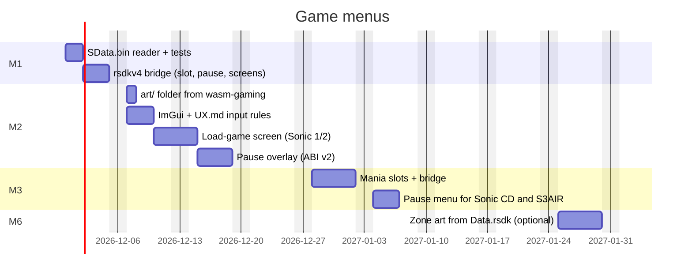

# rsdk-air — game menus: save slots and pause menu (2026-11-20)

## Goal

The owner likes the save-slot screen and the pause menu that play.germade shows. In
the browser those screens come from each wasm-gaming engine's **own app**
(`rsdkv4-wasm/src/app/app.js`, `rsdkv5-wasm/src/app/app.js`, …) and follow the rules in
**engine-specs `UX.md`**. rsdk-air brings the same screens to the native app.

## What the wasm apps do (reference)

| Engine | Load-game screen | Pause menu |
| --- | --- | --- |
| RSDKv4 (Sonic 1/2) | craft's cards: **NO SAVE** + 4 slots. A saved slot shows the zone portrait and tag, character, emeralds, lives and score, plus **CONTINUE**. An empty slot is a character picker (↑/↓) over **PLAY**. **Y** deletes (asks, No focused) | Continue · Change game · the game's own screens (title, level select…) · Settings · Fullscreen · Back to the launcher (asks) |
| RSDKv5 (Mania) | Same cards on Mania's 8 slots (Mighty/Ray only with Plus), plus a card for Mania's own menus | Same |
| RSDKv3 (Sonic CD) | None yet: the game's own title and save select | Continue · game screens · Back |
| Sonic 3 A.I.R. | None yet: the game's own data select | Continue · … · Back |

Shared rules (UX.md): actions, not keys (A accept, B back, Y more, Select+Start or Escape
for the menu in game); one element always focused, with a white ring; the game is paused and
gets no input while a menu is open; Back at the top asks before leaving; deletes ask with No
focused; English and Spanish; targets ≥ 48 px; hints show the pad glyph, then the key.

How the slots work underneath: C++ added to each engine build (`scripts/build.sh` in
`rsdkv4-wasm`, `rsdkv5-wasm`) reads `saveRAM` / Mania's save, deletes a slot, and starts a
game in a slot with a character (`web_get_save_slots`, `web_delete_save`,
`web_start_game`, `web_devmenu_*`). That code is plain C++ against the engine and can be
ported to the native engine modules almost as is.

## Native design

### Where each screen runs

- **Load-game screen: in the launcher process.** Save files are plain data in
  `<root>/saves/<game>/` (RSDKv4 `SData.bin`, Mania `SaveData.bin`, …). The launcher reads
  them **without loading any engine** (the license rule stays intact), draws the cards with
  Dear ImGui, and starts the game process with the choice:

  ```
  rsdk-air --game sonic2 -- --slot 2 --player 1     (slot -1 = NO SAVE)
  ```

  Delete also works from the launcher: it rewrites the slot in the save file, with the same
  rules the engine uses.
- **Pause menu: in the game process, drawn on top of the game.** Select+Start or Escape
  opens it; the engine is paused; Dear ImGui draws on the engine's own graphics context.
  "Change game" closes the game with a dedicated exit code and the launcher reopens the
  slot screen. "Back to the launcher" asks first.

### Engine ABI v2 (planned)

`rsdkair_engine_main` gets a host interface, and the module gets a few optional
functions. A module that does not implement one simply does not offer that entry.

```c
typedef struct RsdkAirHost {
    void *ctx;
    /* Called by the engine module once per frame, after drawing and before presenting. */
    void (*frame)(void *ctx);
    /* Called with every SDL event; returns 1 when the menu consumed it. */
    int  (*event)(void *ctx, const void *sdl_event);
} RsdkAirHost;

/* Engine side, optional: */
void rsdkair_engine_pause(int paused);
int  rsdkair_engine_start_slot(int slot, int player);   /* also via --slot/--player */
int  rsdkair_engine_screens(...);                         /* title, level select… */
void rsdkair_engine_load_screen(int list, int scene);
void rsdkair_engine_request_exit(int code);
```

### Art

**Decision (2026-11-20): reuse the wasm-gaming art** (zone portraits, character icons,
covers and illustrations from `rsdkv4-wasm`, `rsdkv5-wasm` and play.germade), like many
non-profit fan projects (Sonic 3 A.I.R., Retro Sonic, mods) that SEGA has long tolerated.

- All of it lives in one folder, `art/`, with a `art/README.md` listing each file and where
  it came from, so it can be removed or replaced in one go if SEGA ever asks.
- The code never requires it: a missing image falls back to neutral art (coloured zone tag,
  character initials).
- The landing page and releases keep the "Not affiliated with or endorsed by SEGA" notice.
- Later, optional: extract zone art from the player's own `Data.rsdk` instead.

## Milestones affected

- **M1 (RSDKv4)**: port the save bridge (`start_slot`, pause, game screens) into the rsdkv4
  module; save-file reader for `SData.bin` in `rsdkair_core`, with tests.
- **M2 (launcher)**: Dear ImGui UI with the UX.md rules; load-game screen for Sonic 1/2;
  pause overlay in the game process (ABI v2); English and Spanish.
- **M3**: Mania slots (8, with its own bridge); Sonic CD and Sonic 3 A.I.R. get the pause
  menu and keep their own save select until a bridge exists.
- **M6**: settings and controls screens; optionally, zone art from `Data.rsdk`.

## Risks

| Risk | Mitigation |
| --- | --- |
| Each engine draws differently (OpenGL, SDL renderer, software) | ImGui backend per engine (OpenGL 3 / GLES 3, SDL renderer); checked per engine in M1/M3 |
| Sonic 3 A.I.R. already embeds Dear ImGui | Its copy stays hidden inside its module; our overlay uses its own context |
| Mania loads its save only after the title screen | Port the wasm bridge, which replays Mania's own save-select action |

## Schedule


