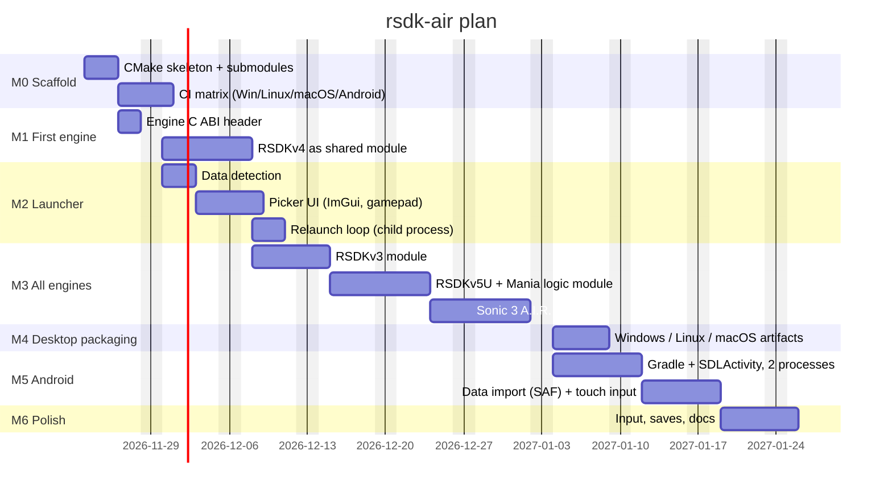

# rsdk-air — plan overview (2026-11-20)

## Goal

One native application, **rsdk-air**, that bundles four game engines and asks at startup
which game to play:

| Engine | Games | Data the player provides |
| --- | --- | --- |
| RSDKv3 (Sonic CD 2011 decompilation) | Sonic CD | `Data.rsdk` |
| RSDKv4 (Sonic 1/2 2013 decompilation) | Sonic 1, Sonic 2 | `Data.rsdk` (one per game) |
| RSDKv5U (RSDKv5 + Sonic Mania decompilation) | Sonic Mania | `Data.rsdk` |
| Sonic 3 A.I.R. (Oxygen Engine, Eukaryot) | Sonic 3 & Knuckles | `Sonic_Knuckles_wSonic3.bin` |

Targets: **Windows, Linux, macOS and Android**.

## Decisions

- **Language: C++20**, built with **CMake**. All four engines are already C++.
- **Platform layer: SDL2**, which all four engines already support and which gives us
  Android through `SDLActivity`.
- **Launcher UI: Dear ImGui** on the SDL2 renderer backend, usable with keyboard,
  gamepad and touch.
- **Each engine is a shared library** with hidden symbols and one exported C entry
  point. **Only one engine runs per process.** See [architecture.md](architecture.md).
- **No game data is shipped.** The launcher detects the player's files and lists only
  the games it can run.

## Scope

In scope:

- Launcher with game detection, a game picker and a way back to the picker after a game exits.
- The four engines built from upstream sources (git submodules, pinned commits).
- Packages: Windows zip (exe + DLLs), Linux AppImage, macOS `.app`, Android APK.
- CI that builds every target.

Out of scope (for now): iOS, mod managers, online features, shipping any game data.

## Milestones

| # | Milestone | Done when |
| --- | --- | --- |
| M0 | Scaffold | CMake project, submodules, CI builds an empty launcher on 4 platforms |
| M1 | First engine | RSDKv4 runs Sonic 1 and Sonic 2 as a module started by the launcher |
| M2 | Launcher | Data detection, picker UI, relaunch loop, settings for data folder |
| M3 | All engines | RSDKv3, RSDKv5U (+ Mania logic) and Sonic 3 A.I.R. run as modules |
| M4 | Desktop packaging | Release artifacts for Windows, Linux and macOS from CI |
| M5 | Android | One APK: launcher process + game process, data import from storage |
| M6 | Polish | Input mapping, save locations, controller navigation, docs |

## Schedule

## Risks

| Risk | Mitigation |
| --- | --- |
| Engines share global symbol names (RSDKv3 vs v4) | One shared library per engine with hidden visibility; one engine per process |
| Engines assume they own the process (`exit()`, `SDL_Quit`, global state) | The launcher runs each game in a child process (desktop) or a separate Android process |
| Sonic 3 A.I.R. build is large and has its own framework (rmx, oxygen) | Do it last; start from its own CMake and Android projects |
| RSDKv5U loads game logic dynamically (`Game.dll`) | Link the Mania logic into the v5 module (static game logic option) |
| Sonic 3 A.I.R. is GPL-3.0 and the RSDK engines are non-commercial: they cannot be combined | Never in the same process (aggregation only); see upstreams-and-licensing.md |
| macOS signing/notarization | Unsigned builds for now; signing is a later decision |

## Open questions

- Upstream repositories and pinned tags: resolved, see
  [upstreams-and-licensing.md](upstreams-and-licensing.md).
- License for our own code: options in [upstreams-and-licensing.md](upstreams-and-licensing.md).
- Where game data lives by default on each platform (proposed: SDL `SDL_GetPrefPath`,
  one folder per game).
