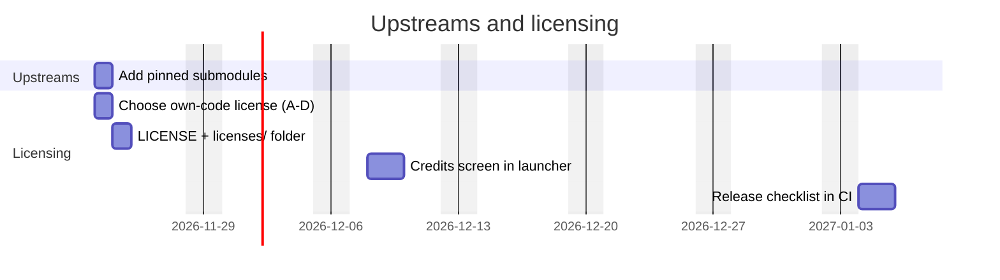

# rsdk-air — upstreams and licensing (2026-11-20)

## Pinned upstreams

The latest **stable release tag** of each engine, added as git submodules under
`third_party/`:

| Engine | Repository | Tag | Commit | Date |
| --- | --- | --- | --- | --- |
| RSDKv3 (Sonic CD) | `RSDKModding/RSDKv3-Decompilation` | `1.3.3` | `6ecf9590d161` | 2025-11-01 |
| RSDKv4 (Sonic 1/2) | `RSDKModding/RSDKv4-Decompilation` | `1.3.3` | `f5f1e87e2b19` | 2025-11-01 |
| RSDKv5U | `RSDKModding/RSDKv5-Decompilation` | `v1.1.1` | `bd5939658fa9` | 2025-10-31 |
| Sonic Mania logic | `RSDKModding/Sonic-Mania-Decompilation` | `v1.1.1` | `56cf1bbac45e` | 2025-11-01 |
| Sonic 3 A.I.R. | `Eukaryot/sonic3air` | `v26.03.28.0-stable` | `29cf83c9dcc2` | 2026-03-25 |

Notes:

- These are the official repositories (RSDKModding is where Rubberduckycooly's
  decompilations live now). `sonic3air-wasm` uses the same Sonic 3 A.I.R. tag.
- All of them build with SDL2: RSDKv3/v4 default to `RETRO_SDL_VERSION 2`, and
  Sonic 3 A.I.R. bundles SDL in `framework/external/sdl` and has its own CMake and
  Android builds.
- RSDKv5U supports `GAME_STATIC`, so the Mania logic can be linked into the v5 module
  instead of being loaded as a separate `Game` library.
- Upgrading a pin is a deliberate change, recorded in `RECORD/`.

## Licenses of the upstreams

| Component | License | Key terms |
| --- | --- | --- |
| RSDKv3, RSDKv4 | RSDKv3/v4 Decompilation License v2 | Non-commercial; credit original and decompilation authors; no game assets; **pre-built binaries must have DLC (Plus) off by default** (`RETRO_DISABLE_PLUS=ON`); license kept in modified copies and forks |
| RSDKv5U | RSDKv5(U) Decompilation License v2.1 | Same terms as v3/v4 |
| Sonic Mania decompilation | Sonic Mania Decompilation License v1 | Non-commercial; credit; no game assets; license kept in copies and forks |
| Sonic 3 A.I.R. | **GPL-3.0** | Copyleft: whoever receives a binary must be able to get the source, and the program cannot carry extra restrictions |
| SDL2 | zlib | Permissive |
| Dear ImGui | MIT | Permissive |

### The conflict

The GPL-3.0 does not allow extra restrictions on a combined work, and the RSDK
licenses add one ("no commercial use"). So **Sonic 3 A.I.R. and any RSDK engine must
never be combined into one program**: not linked together, and not loaded as modules
into the same process.

Shipping them **side by side** in one zip, AppImage or APK is allowed ("aggregation",
GPL-3.0 section 5), as long as they stay separate programs that only start each other
(command line, `exec`, a separate Android process).

The process model in [architecture.md](architecture.md) already does this: one engine
per process, and a game never runs in the launcher's process. That rule is now a
**legal requirement**, not just a technical one.

## License for our own code

The launcher code ends up in the same process as both a GPL engine and the RSDK
engines, so it has to be compatible with both.

**Decision (2026-11-20): option A, MIT** (`LICENSE`). The project is open source and non-profit.

| Option | Works with GPL S3AIR | Works with RSDK | Notes |
| --- | --- | --- | --- |
| **A. MIT or zlib (recommended)** | Yes | Yes | Simple, matches SDL2/ImGui; anyone may reuse the launcher |
| B. GPL-3.0 | Yes | **No** in the same process as RSDK | Would require a separate, non-GPL host for RSDK engines |
| C. Copy the RSDK non-commercial terms | **No** in the same process as S3AIR | Yes | Would require a separate host for S3AIR |
| D. MPL-2.0 | Yes | Yes | File-level copyleft: changes to our files stay open; more complex |

Whatever we pick, the **distributed bundle as a whole is non-commercial**, because the
RSDK engines are: no paid builds, no ads, no in-app payments.

## Release checklist (from the licenses)

- [ ] `RETRO_DISABLE_PLUS=ON` in every CI/release build of RSDKv3, v4 and v5U. It defines
      `RSDK_AUTOBUILD=1`, which in the upstream code:
      - sets `game.hasPlusDLC` to 0 (RSDKv3/v4 and v5's legacy modes);
      - RSDKv3 (Sonic CD): blocks playing as Knuckles or Amy and skips Amy's hammer hitboxes;
      - RSDKv4 (Sonic 1/2): blocks playing as Amy;
      - RSDKv5U (Mania): forces every DummyCore DLC value off, so no Mania Plus content
        (Mighty, Ray, Encore mode).
      Base games are unaffected. A setting to turn DLC on is allowed only if it is off by default.
- [ ] Each engine's license file shipped next to its module (`licenses/` folder).
- [ ] A credits screen in the launcher naming Christian Whitehead (RSDK v3/v4), Evening Star
      (RSDK v5), Rubberduckycooly, st×tic and chuliRMG (decompilations), and Eukaryot
      (Sonic 3 A.I.R.).
- [ ] Corresponding source for the Sonic 3 A.I.R. module available (public repo, pinned
      submodule and our patches; link from the release and the credits screen).
- [ ] No game data, ROMs or extracted assets in the repository, CI artifacts or releases.
- [ ] No SEGA names, logos or artwork in the app name, icon or store listing.
- [ ] Distribution through GitHub Releases (sideloaded APK). Not Google Play: a Sonic fan
      app there is likely to be taken down for trademark reasons.

## Schedule

