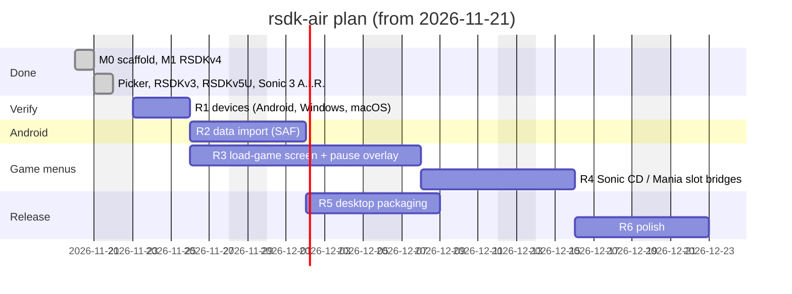

# rsdk-air — plan overview (2026-11-21)

Replaces [`../2026-11-20/overview.md`](../2026-11-20/overview.md) for scope and schedule.
The architecture ([`../2026-11-20/architecture.md`](../2026-11-20/architecture.md)), game
menus and licensing documents of 2026-11-20 still apply, except where noted below.

## Where things stand

| Game | Engine | Desktop (Linux/Windows/macOS) | Android |
| --- | --- | --- | --- |
| Sonic 1, Sonic 2 | RSDKv4 module | Playable (verified with real data on Linux) | Builds |
| Sonic CD | RSDKv3 module | Playable (verified on Linux) | Builds |
| Sonic Mania | RSDKv5U module, Mania logic linked in | Playable (verified on Linux) | Builds (SDL2 subsystem) |
| Sonic 3 A.I.R. | Official build, separate program | Installed by the picker and launched (verified on Linux) | Official app launched with the ROM |

- Launcher: cover-mosaic picker (Dear ImGui), games detected by data **and** engine;
  Sonic 3 A.I.R. install with progress. Message-box picker as fallback.
- CI: `build.yml` (main, manual runs) builds and tests Linux, Windows, macOS (now on
  `macos-15`) and Android; `android.yml` runs on `[android]` commits.

## What changed since 2026-11-20

- **Sonic 3 A.I.R. is not an engine module.** It is GPL-3.0, actively maintained and
  moving to SDL 3, so rsdk-air does not build or link it:
  - Desktop: the picker downloads the official release (pinned version and SHA-256) into
    `<data>/apps/sonic3air/<version>/` and runs it as a separate program, pointing it at the
    player's ROM and `audioremaster.bin`.
  - Android: the picker launches the official app (`org.eukaryot.sonic3air`) and hands it
    the ROM through a read-only content URI; without the app it links to sonic3air.org.
- **RSDKv5 on Android** is built as the engine's Linux flavour (SDL2 subsystem, plain
  files, no JNI) instead of upstream's GameActivity path. Mania then needs a pad or
  keyboard, as on PC.
- **Picker art**: covers from play.germade in `art/` (removable, provenance listed), 4:5,
  one row.

## Remaining work

| # | Item | Notes |
| --- | --- | --- |
| R1 | Verify on devices | Android APK on a phone (all games), Windows and macOS runs (incl. Sonic 3 A.I.R. install with curl/tar/hdiutil) |
| R2 | Android data access | Getting `Data.rsdk` / ROM onto the device: import with the system file picker (SAF) into the app's data folder |
| R3 | Save-slot screens (M2 of game-menus.md) | Load-game screen in the launcher for Sonic 1/2 (bridge exists); pause overlay (engine ABI v2) |
| R4 | Sonic CD / Mania slot bridges | Start a slot directly; needed for pad-only play with the mobile Sonic CD data, whose main menu is touch-only |
| R5 | Desktop packaging (M4) | Release artifacts per platform (`release.yml`), macOS `.app` bundle |
| R6 | Polish (M6) | Input mapping, Spanish texts (UX.md), docs |

## Schedule

