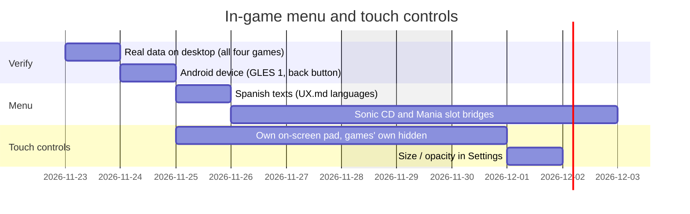

# rsdk-air — the in-game menu (2026-11-22)

Replaces the "Where each screen runs" part of
[`../2026-11-20/game-menus.md`](../2026-11-20/game-menus.md); the rest of that document
(art, rules from engine-specs UX.md) and [`../2026-11-21/overview.md`](../2026-11-21/overview.md)
still apply.

## Decision

The owner asked for **one menu, the same when a game opens and when it is paused**: the
save slots, graphics and sound options, the game's special screens, and back to the
launcher. So the save-slot screen moves **out of the launcher into the game process**:

- Launcher: Play on a cover starts the game. No slot screen there any more.
- Game process: the menu is drawn over the engine's own window, through the engine's own
  graphics, by the launcher executable (which is what runs the game process); the engine
  is blocked inside a hook while it is open, so the game is frozen.

| | When the game opens | When paused (Escape, Android back, Select + Start, Guide) |
| --- | --- | --- |
| Heading | "Load game" (with slots) or the game's name | "Paused", over the frozen frame |
| Slots (Sonic 1/2) | NO SAVE + 4 slots (rsdkv4-wasm's cards) | same: start, continue or delete a slot mid-game |
| First button | Title screen / Play (the game's own start) | Continue |
| Then | the game's screens (title, level select, stage menu, Mania's main menu), Settings, Back to the launcher (asks only when a game is running) | same |

Settings (engine's own settings file): music volume, sound volume, smoothing, fullscreen
(desktop).

## How

- **Engine ABI 2** (`include/rsdkair/engine.h`): `RsdkAirHost` (attach / event / frame
  hooks the engine calls) and `RsdkAirEngineControl` (what the module offers).
- **Host**: `src/launcher/game_menu.cpp`, Dear ImGui with two renderers: fixed-function
  OpenGL 1.x / ES 1.x (RSDKv3/v4 ask for a 1.0 context; power-of-two textures, state saved
  and restored) and SDL_Renderer (RSDKv5; logical size saved and restored). The paused
  backdrop is the last frame, copied before it is presented.
- **Engines**: three small patches each (event loop, before present, declarations) plus
  module code (`engines/common/menu_glue.hpp`).
- `rsdkair_menu_demo`: a stand-in engine (both renderers) to try the menu without data.

## Next

Risks: the GL 1 renderer is only checked on Mesa (desktop GL); GLES 1 on Android and the
RSDKv5 renderer under a real game are unverified until a device and real data are used.
